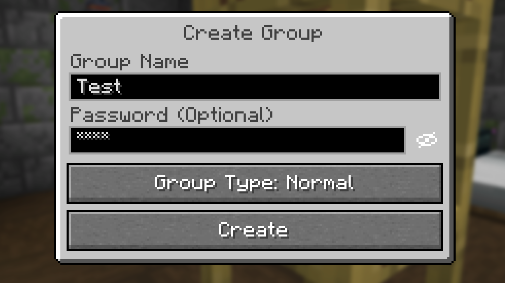

# 🔒 SVC Password Hide

### Your group. Your password. Your choice to show it.

Keep your Simple Voice Chat group password hidden while you play, record, or stream.

[Installation](#-installation) · [Compatibility](#-compatibility) · [How to use](#-how-to-use) · [FAQ](#-faq)

---

Creating or joining a password-protected voice chat group shouldn't mean switching
your OBS scene just to type a password. **SVC Password Hide** masks those fields
with `*****` by default and adds an eye button to reveal the password when you want to.

**Install it on your own client. Your server and friends don't need this add-on.**

## 📸 In game

  
   
  Your password stays masked while you create a group.

## ✨ What you get

| Feature | What it does for you |
| :--- | :--- |
| 🔒 **Hidden by default** | Masks passwords when creating a group or joining a protected group. |
| 👁️ **Click to reveal** | Shows or hides the password with a single click. The dark eye button is easy to spot. |
| ↩️ **Resets to hidden** | Hides the password again when you reopen the dialog or resize the window. |
| ⌨️ **Familiar controls** | Keeps typing, pasting, selecting, and editing working as usual. You can also reach the eye button with Tab. |
| 🔇 **Private narration** | Keeps Minecraft's narrator from reading the password aloud while it's hidden. |
| 🌍 **English & German** | Includes translated button labels and tooltips. |
| 💻 **Client only** | Works on your own installation without adding anything to the server. |

## 📦 Installation

1. **Install Simple Voice Chat** for your Minecraft version and mod loader, including
   any dependencies it requires. [Get Simple Voice Chat →](https://modrinth.com/mod/simple-voice-chat)
2. **[Download SVC Password Hide](https://github.com/playmonkeei/mc-svc-password-hide/releases/latest)** and choose the JAR matching your Minecraft version
   and loader. If you downloaded the ZIP, extract it first and open your version's folder.
3. **Put that one JAR in your client's `mods` folder**, alongside Simple Voice Chat.
   Replace any older SVC Password Hide JAR.
4. **Launch Minecraft.** Open the voice chat group menu and use it as usual.

> 💡 Using a launcher such as Prism or Modrinth App? Open the folder for the
> specific instance you play, then place the JAR in that instance's `mods` folder.

### Choose your file

| Your loader | File ending |
| :--- | :--- |
| Fabric **or** Quilt | `-fabric-quilt.jar` |
| Forge | `-forge.jar` |
| NeoForge | `-neoforge.jar` |

The Minecraft version is also part of the filename. For example,
`svc-password-hide-1.0.1+26.1.2-fabric-quilt.jar` is the Fabric/Quilt download for
Minecraft **26.1.2**.

## 🧩 Compatibility

| Minecraft | Fabric | Quilt | Forge | NeoForge |
| :--- | :---: | :---: | :---: | :---: |
| 26.1 | ✅ | ✅ | ✅ | ✅ |
| 26.1.1 | ✅ | ✅ | ✅ | ✅ |
| 26.1.2 | ✅ | ✅ | ✅ | ✅ |
| 26.2 | ✅ | ✅ | ✅ | ✅ |
| 26.3 | ✅ | ✅ | ✅ | ✅ |

**Requires:** Java **25** and Simple Voice Chat **2.6.x** for your Minecraft version
and loader. Automated compatibility checks use Simple Voice Chat **2.6.24**;
earlier 2.6.x releases have not been checked individually.

Builds and automated compatibility checks cover all versions in the table. A full
in-game test has not been performed for every loader/version combination.

## 👁️ How to use

1. Open **Create Group**, or join a group that asks for a password.
2. Type or paste your password. It appears as **stars immediately**.
3. Click the **eye button** to show it. Click again to hide it.

The next time you open the dialog, the password starts hidden again. There is
**nothing to configure**.

> 🎥 Revealing the password also makes it visible to your recording or stream.
> Leave it masked whenever your game is being captured.

## 💬 FAQ

<strong>Does the server need this add-on?</strong>

No. Install SVC Password Hide on your client only. Your server still needs its
normal Simple Voice Chat setup, but no changes are needed for this add-on.

<strong>Do other players need it?</strong>

No. It changes the password fields on your screen. Other players can keep using
Simple Voice Chat as usual.

<strong>Does it change my password or how groups work?</strong>

No. It changes how the password is displayed. The original password is still used
to create or join the group.

<strong>Do I need OBS integration or a special streaming setup?</strong>

No. The masking happens inside Minecraft, so it also works for screenshots,
recordings, and playing without a stream.

<strong>I can't see the eye button. What should I check?</strong>

Make sure Simple Voice Chat and SVC Password Hide are installed in the same client
instance, and that you chose the correct Minecraft version and loader. Remove any
older copy of this add-on, restart Minecraft, and open a group password dialog.

---

Made by **playmonkeei** · [MIT License](LICENSE)

An independent, unofficial add-on for [Simple Voice Chat](https://github.com/henkelmax/simple-voice-chat)
by **henkelmax**.

[Developer documentation](docs/DEVELOPMENT.md)

